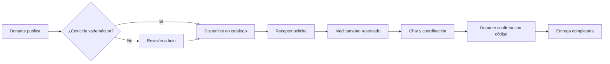

# ecofarma

Plataforma web para **donar y recibir medicamentos entre particulares** de forma coordinada y trazable. Los donantes publican medicamentos en buen estado que les sobran; quienes los necesitan los solicitan; ambos acuerdan el encuentro por **chat en tiempo real** y cierran la entrega con un **código de confirmación** que solo conoce el receptor.

El objetivo es reducir el desperdicio de medicamentos útiles y acercar el acceso a quienes los necesitan, con reglas de negocio alineadas al **vademécum de referencia (Programa Remediar)** y controles cuando la donación requiere receta médica.

---

## Contenido

- [Qué hace la aplicación](#qué-hace-la-aplicación)
- [Flujo principal](#flujo-principal)
- [Stack técnico](#stack-técnico)
- [Arquitectura y seguridad](#arquitectura-y-seguridad)
- [Estructura del repositorio](#estructura-del-repositorio)
- [Requisitos](#requisitos)
- [Configuración local](#configuración-local)
- [Comandos habituales](#comandos-habituales)
- [Documentación interna](#documentación-interna)
- [Estado del proyecto](#estado-del-proyecto)
- [Contribuir](#contribuir)

---

## Qué hace la aplicación

### Para donantes

- Registro con datos de contacto y aceptación de declaración jurada (DDJJ).
- Publicación de donaciones con fotos del envase, lote, vencimiento y datos del medicamento.
- Validación automática contra el vademécum: coincidencia exacta por principio activo, concentración y forma farmacéutica → publicación directa; caso contrario → revisión por un administrador.
- Seguimiento en **Mis donaciones** y chat con el receptor para coordinar la entrega.
- Confirmación de entrega ingresando el código que el receptor obtiene en su perfil.

### Para receptores

- Catálogo público de medicamentos **disponibles** y **no vencidos** (rutas `/recibir` y `/catalogo`).
- Solicitud de un medicamento; si aplica, carga de receta en almacenamiento privado.
- Chat con el donante y código de confirmación para cerrar la operación en persona.
- Gestión de solicitudes en **Mis solicitudes**.

### Para administradores

- Moderación de donaciones en revisión o rechazadas (aprobar, rechazar con motivo, corregir datos).
- Alta de entradas nuevas en el vademécum cuando hace falta.
- Gestión de cuentas: suspender, rehabilitar, promover o revocar rol de administrador (con salvaguardas para no dejar el sistema sin admins).

---

## Flujo principal



Las acciones sensibles (publicar, solicitar, confirmar, cancelar, moderar, gestionar usuarios) **no se ejecutan con inserts directos desde el navegador**: pasan por **Edge Functions** que validan sesión, cuenta habilitada y reglas de negocio. PostgreSQL aplica **Row Level Security (RLS)** en todas las tablas.

---

## Stack técnico

| Capa | Tecnología |
|------|------------|
| Frontend | Vue 3 (Composition API, SPA), Vue Router, Tailwind CSS 4, Vite |
| Iconos | Lucide (`@lucide/vue`) |
| Backend | Supabase: PostgreSQL, Auth, Storage, Realtime |
| Servidor | Edge Functions en **JavaScript** sobre Deno |
| Paquetes | pnpm |

El cliente en el navegador usa `@supabase/supabase-js` con la **clave anónima (publishable)**. La clave de servicio (`service_role`) **solo** vive como secreto en el entorno de las Edge Functions, nunca en el frontend ni en el repositorio.

---

## Arquitectura y seguridad

```
┌─────────────┐     anon key + JWT      ┌──────────────────────────┐
│  Vue (SPA)  │ ───────────────────────►│ Supabase                 │
│  src/       │   select/update RLS     │  PostgreSQL + RLS        │
└──────┬──────┘   Storage (buckets)     │  Auth · Realtime         │
       │                                 └───────────┬──────────────┘
       │  supabase.functions.invoke                  │
       └────────────────────────────────────────────►│ Edge Functions │
                                                     │ (validación)   │
                                                     └────────────────┘
```

- **Cinco tablas de dominio:** perfiles, vademécum habilitado, medicamentos (donaciones), solicitudes y mensajes de chat. Detalle en [`docs/base-de-datos.md`](docs/base-de-datos.md).
- **Storage:** fotos de envase (bucket público con rutas por usuario) y recetas (bucket privado).
- **Realtime:** mensajes del chat vía cambios en Postgres.
- **Frontend:** un solo cliente en `src/lib/supabase.js`; lógica de datos y formularios en `src/composables/`; una vista por ruta en `src/views/`.

### Edge Functions

| Función | Rol |
|---------|-----|
| `publicar-medicamento` | Alta de donación tras subida de fotos |
| `crear-solicitud` | Reserva del medicamento y creación del pedido |
| `confirmar-entrega` | Cierre exitoso con código de confirmación |
| `cancelar-solicitud` | Cancelación por donante o receptor |
| `moderar-donacion` | Aprobación, rechazo o corrección (admin) |
| `alta-medicamento-habilitado` | Nueva fila en vademécum (admin) |
| `gestionar-usuarios` | Suspender, rehabilitar, roles (admin) |

---

## Estructura del repositorio

```
.
├── index.html
├── public/                 # Estáticos (favicon, imágenes, robots.txt)
├── src/
│   ├── main.js
│   ├── App.vue
│   ├── style.css           # Tailwind, tokens @theme, utilidades de layout
│   ├── lib/supabase.js     # Cliente único de Supabase
│   ├── router/index.js     # Rutas y guards (sesión, admin, invitados)
│   ├── composables/        # Auth, medicamentos, solicitudes, chat, admin…
│   ├── views/              # Pantallas por ruta
│   └── components/         # UI y layout (navbar, modal, toast, inputs…)
├── supabase/
│   ├── config.toml
│   ├── migrations/         # Esquema SQL versionado
│   ├── seed.sql            # Datos de desarrollo (no incluir secretos reales)
│   └── functions/          # Edge Functions (una carpeta por función)
├── docs/
│   ├── base-de-datos.md    # Modelo, RLS y Storage
│   └── convenciones-visuales.md
├── ROADMAP.md              # Fases, esquema detallado e inventario de pantallas
└── AGENTS.md               # Convenciones para desarrollo con agentes
```

---

## Requisitos

- **Node.js** (LTS recomendado) y **pnpm** (versión indicada en `packageManager` del `package.json`).
- **Supabase CLI** (incluida como dependencia de desarrollo; invocar con `pnpm supabase`).
- **Deno** (runtime de las Edge Functions en local y en despliegue).

Para desarrollo full-stack necesitas un **proyecto de Supabase** (local con `supabase start` o remoto vinculado con `link`). Las credenciales del proyecto **no** deben subirse a GitHub.

---

## Configuración local

1. Clonar el repositorio e instalar dependencias:

   ```bash
   pnpm install
   ```

2. Copiar la plantilla de entorno y completar **solo** las variables públicas del proyecto Supabase:

   ```bash
   cp .env.example .env.local
   ```

   En `.env.local`:

   ```env
   VITE_SUPABASE_URL=https://<tu-proyecto>.supabase.co
   VITE_SUPABASE_ANON_KEY=<tu-clave-anon-o-publishable>
   ```

   **No commitear** `.env.local` ni pegar claves en issues, PRs o capturas.

3. Vincular la CLI al proyecto (sustituir el identificador por el de tu instancia):

   ```bash
   pnpm supabase link --project-ref <project-ref>
   ```

4. Aplicar migraciones al remoto (cuando corresponda):

   ```bash
   pnpm supabase db push
   ```

5. Levantar el frontend:

   ```bash
   pnpm dev
   ```

6. (Opcional) Servir Edge Functions en local, con secretos configurados en el dashboard o con `pnpm supabase secrets set`:

   ```bash
   pnpm supabase functions serve
   ```

El archivo `supabase/seed.sql` está pensado para **entornos de desarrollo**. Tras un reset local, revisa la documentación del equipo o el propio seed para cuentas de prueba; **no publiques contraseñas ni correos reales** en el README ni en commits.

---

## Comandos habituales

| Acción | Comando |
|--------|---------|
| Desarrollo frontend | `pnpm dev` |
| Build producción | `pnpm build` |
| Preview del build | `pnpm preview` |
| Nueva migración | `pnpm supabase migrations new <nombre>` |
| Aplicar migraciones | `pnpm supabase db push` |
| Servir funciones local | `pnpm supabase functions serve` |
| Desplegar una función | `pnpm supabase functions deploy <nombre>` |
| Secretos (remoto) | `pnpm supabase secrets set NOMBRE=valor` |

Usar siempre el prefijo `pnpm supabase`, no la CLI suelta ni `npx`, para alinear versiones con el proyecto.

---

## Documentación interna

| Archivo | Contenido |
|---------|-----------|
| [`ROADMAP.md`](ROADMAP.md) | Estado por fases, decisiones de producto, esquema de columnas, inventario de rutas |
| [`docs/base-de-datos.md`](docs/base-de-datos.md) | Tablas, RLS, buckets y funciones de seguridad en SQL |
| [`docs/convenciones-visuales.md`](docs/convenciones-visuales.md) | Tokens, tipografía y patrones de UI |
| [`AGENTS.md`](AGENTS.md) | Stack, git flow y reglas para cambios automatizados |

---

## Estado del proyecto

**MVP funcional (fases 1–9):** catálogo, auth, perfil, donaciones, solicitudes, chat, confirmación/cancelación, panel de administración y gestión de usuarios. La interfaz prioriza HTML semántico y Tailwind; el **pulido visual** pantalla a pantalla y la **landing pública** (fase 10) están planificados en `ROADMAP.md`.

Ramas habituales: `main` (producción), `dev` (integración), features desde `dev` como `featureNN/<nombre>`.

---

## Contribuir

1. Partir de `dev` actualizado y crear una rama de feature.
2. Respetar RLS, migraciones incrementales (no editar migraciones ya aplicadas) y reglas de negocio en Edge Functions.
3. No incluir en el repositorio: `.env.local`, claves `service_role`, tokens personales ni datos reales de pacientes.
4. Integrar en `dev` tras revisar que la app levanta y el flujo tocado funciona; promover a `main` solo cuando `dev` esté verificado.

Si usas este repo como portfolio o demo, configura tu **propio** proyecto Supabase y variables de entorno; no dependas de credenciales compartidas en el código.

---

## Licencia

Sin archivo de licencia en el repositorio por el momento. Consulta al mantenedor antes de reutilizar el código en otros proyectos.
