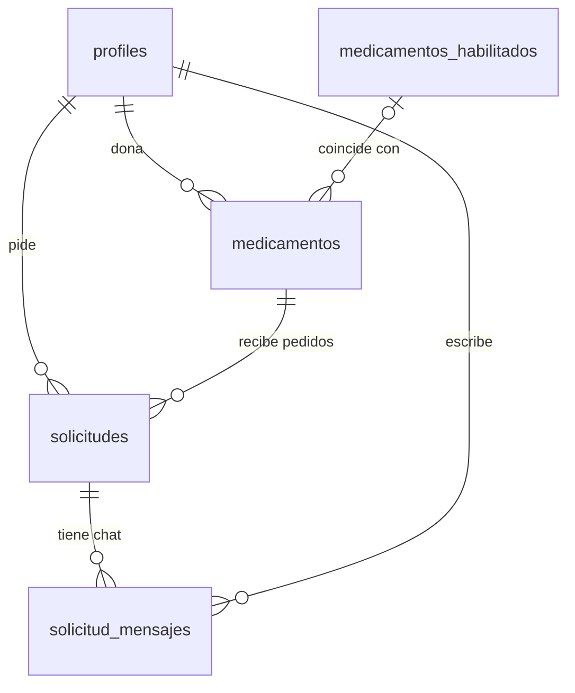

# Base de datos de EcoFARMA

Cómo está armada la base y cómo se protege. El detalle de columnas, tipos y claves está en `ROADMAP.md` (sección 4). Las reglas para tocarla están en `AGENTS.md`.

---

## 1. Dónde se guardan los datos

EcoFARMA usa **Supabase** (PostgreSQL) más estas piezas:

- **Auth:** registro e inicio de sesión. El email y la contraseña no están en las tablas de abajo.
- **Storage:** fotos de envases y recetas. Las tablas guardan solo la URL.
- **Realtime:** el chat, sin recargar la página.
- **Edge Functions:** programas en el servidor para las acciones que no pueden quedar en el navegador.

La aplicación (Vue) se conecta directo a Supabase. La base decide quién ve o cambia cada fila.

Hay 5 tablas:

| Tabla | Qué guarda |
|---|---|
| `profiles` | Datos de cada usuario, aparte del email y la contraseña |
| `medicamentos_habilitados` | Vademécum oficial (Programa Remediar) |
| `medicamentos` | Donaciones publicadas |
| `solicitudes` | Pedidos para recibir un medicamento |
| `solicitud_mensajes` | Mensajes del chat de cada pedido |

Un usuario dona muchos medicamentos y hace muchas solicitudes. Una donación puede coincidir con una fila del vademécum. Cada solicitud pide un medicamento y tiene su chat.

Todas las tablas tienen `id` y `created_at`. `updated_at` está en todas menos en el chat, porque los mensajes no se editan.

---

## 2. Qué significa cada tabla

### `profiles`

El perfil se crea solo al registrarse, con un trigger sobre `auth.users`. El rol arranca en `user`. Si la persona no aceptó la DDJJ, o le falta nombre, DNI, teléfono, dirección o localidad, el trigger cancela el alta.

| Columna | Significado |
|---|---|
| `name`, `dni` | Nombre y DNI. El DNI no se repite |
| `telefono`, `direccion`, `localidad` | Contacto |
| `rol` | `user` o `admin` |
| `is_validado` | Cuenta habilitada. Arranca en `true`. El admin la pasa a `false` para suspenderla |
| `acepto_ddjj`, `fecha_aceptacion_ddjj` | Si aceptó la Declaración Jurada, y cuándo |

El usuario puede editar nombre, DNI, teléfono, dirección y localidad. El email se cambia por Auth, no por una columna de esta tabla. No puede cambiar `rol`, `is_validado` ni la DDJJ.

### `medicamentos_habilitados`

Listado de referencia para aceptar o retener una donación. Remediar usa nombres genéricos, así que la marca es opcional.

| Columna | Significado |
|---|---|
| `principio_activo` | La droga |
| `concentracion` | Cantidad de droga |
| `forma_farmaceutica` | Comprimido, jarabe, etc. |
| `nombre_comercial` | Marca, si la hay |
| `presentacion` | Por ejemplo, caja por 20 |
| `requiere_receta` | `true` en antibióticos y psicofármacos |

La coincidencia de una donación usa principio activo, concentración y forma. No usa la marca.

### `medicamentos`

Una fila es una donación. Concentración, forma farmacéutica y lote son obligatorios.

| Columna | Significado |
|---|---|
| `user_id` | Quién donó |
| `medicamento_habilitado_id` | Fila del vademécum con la que coincidió. Vacío si no coincidió |
| `nombre_comercial`, `principio_activo`, `concentracion`, `forma_farmaceutica` | Datos del medicamento |
| `cantidad_disponible` | Unidades. No puede ser negativa |
| `lote` | Lote del envase |
| `fecha_vencimiento` | Vencimiento |
| `fotos_envase` | Hasta 3 URLs de fotos |
| `descripcion` | Comentario opcional |
| `estado` | Situación de la donación |
| `motivo_rechazo` | Por qué el admin la rechazó, si aplica |

Estados: `disponible` (se ve en el catálogo), `pendiente_revision` (no coincidió y espera al admin), `reservado` (alguien lo pidió), `entregado`, `rechazado`.

### `solicitudes`

El pedido de un receptor. No se puede borrar el medicamento mientras exista el pedido.

| Columna | Significado |
|---|---|
| `medicamento_id` | Qué medicamento pide |
| `receptor_id` | Quién lo pide |
| `es_para_tercero`, `nombre_destinatario_final` | Si es para otra persona, y el nombre de esa persona |
| `receta_medica_url` | Foto de la receta, si hace falta |
| `codigo_confirmacion` | Seis dígitos para la entrega en persona. El frontend no puede leer esta columna |
| `acepto_ddjj_receptor`, `fecha_aceptacion_ddjj` | DDJJ del receptor |
| `estado` | Situación del pedido |
| `fecha_entrega` | Cuándo se entregó |

Estados: `pendiente_coordinacion` (están acordando el encuentro), `en_camino` (previsto; hoy ninguna acción lo asigna), `completado`, `cancelado`.

El código lo ve solo el receptor. En el encuentro se lo dice al donante, y el donante lo carga en la app.

### `solicitud_mensajes`

Un mensaje del chat. Solo participan el donante y el receptor de esa solicitud. El texto no puede ir vacío.

Realtime avisa el mensaje nuevo a quien tiene el chat abierto y, antes, aplica las mismas reglas de lectura de la sección 4.

---

## 3. Dos candados

Para tocar un dato hay que pasar los dos:

1. **GRANT:** ¿este rol puede usar esta tabla, y para qué operación?
2. **RLS:** de esa tabla, ¿qué filas?

El GRANT es la llave del edificio. La política RLS dice a qué departamentos se entra adentro.

| Rol | Quién es |
|---|---|
| `anon` | Visitante sin sesión |
| `authenticated` | Usuario con sesión |
| `service_role` | Las Edge Functions. Ignora RLS. No se usa en el frontend |

En EcoFARMA los permisos de `anon` y `authenticated` no vienen dados: cada tabla nueva necesita su `GRANT`. Eso está en la migración `table_grants`. `service_role` los recibe por defecto.

Operaciones: `select` (leer), `insert` (crear), `update` (modificar), `delete` (borrar).

### Permisos

| Tabla | Visitante | Usuario con sesión |
|---|---|---|
| `profiles` | Nada | Leer. Modificar `name`, `dni`, `telefono`, `direccion` y `localidad` |
| `medicamentos_habilitados` | Leer | Leer |
| `medicamentos` | Leer | Leer |
| `solicitudes` | Nada | Leer todas las columnas menos `codigo_confirmacion` |
| `solicitud_mensajes` | Nada | Leer y crear mensajes |

El usuario no puede modificar `rol`, `is_validado` ni la DDJJ. Si pudiera leer `codigo_confirmacion`, el donante confirmaría la entrega sin el receptor. El receptor lo pide con `obtener_codigo_confirmacion` (sección 5).

---

## 4. Políticas RLS

RLS está activo en todas las tablas. Si no hay política para una operación, esa operación no devuelve ni cambia filas.

**`profiles`.** Cada uno ve y edita el propio. El admin ve todos.

**`medicamentos_habilitados`.** Cualquiera lo lee, con o sin sesión.

**`medicamentos`.** Cualquiera ve los disponibles y no vencidos. El donante ve todas las suyas. El receptor ve las que pidió. El admin ve todas. Con sesión esas reglas se suman: por eso el catálogo filtra otra vez en la consulta.

**`solicitudes`.** Las leen los dos participantes y el admin. No hay política de alta: solo las crea la Edge Function `crear-solicitud`.

**`solicitud_mensajes`.** Leen los dos participantes. Para escribir hace falta ser participante, usar el propio usuario, tener `is_validado = true` y que la solicitud esté en `pendiente_coordinacion` o `en_camino`.

---

## 5. Funciones

Comprobaciones que usan varias políticas. Son `security definer`: corren con permisos elevados y, adentro, controlan quién pregunta.

| Función | Responde |
|---|---|
| `es_admin()` | Si el usuario actual es administrador |
| `es_participante(solicitud)` | Si es el donante o el receptor |
| `solicito_medicamento(medicamento)` | Si pidió ese medicamento |
| `participantes_solicitud(solicitud)` | Solo el nombre de las dos personas |
| `obtener_codigo_confirmacion(solicitud)` | El código de 6 dígitos, solo si pregunta el receptor |

Las dos últimas las llama el frontend con `rpc`.

---

## 6. Archivos

Las fotos no van en las tablas.

| Bucket | Acceso | Qué guarda |
|---|---|---|
| `fotos-envases` | Público | Fotos de envase. El catálogo las muestra sin sesión |
| `recetas-medicas` | Privado | Recetas |

Los dos aceptan JPG, PNG o WEBP de hasta 5 MB. Cada usuario sube, ve y borra solo en su carpeta (`<user_id>/…`). No se reemplaza un archivo: no hay política de `update`.

---

## 7. Qué hace el frontend y qué hace el servidor

| Acción | Quién |
|---|---|
| Editar nombre, DNI, teléfono, dirección y localidad | Frontend, sobre `profiles` |
| Cambiar el email | Frontend, con `auth.updateUser` |
| Enviar un mensaje | Frontend, sobre `solicitud_mensajes` |
| Publicar una donación | `publicar-medicamento` |
| Crear una solicitud | `crear-solicitud` |
| Confirmar la entrega | `confirmar-entrega` |
| Cancelar y liberar el medicamento | `cancelar-solicitud` |
| Aprobar, corregir o rechazar | `moderar-donacion` |
| Sumar una fila al vademécum | `alta-medicamento-habilitado` |
| Listar cuentas, suspender, rehabilitar, promover o revocar | `gestionar-usuarios` |

Esas funciones corren en el servidor porque comprueban reglas que el navegador podría saltear: receta, código, reserva del medicamento, rol de admin.

---

## 8. Migraciones

Cada archivo de `supabase/migrations/` se aplica una vez, en orden.

| Migración | Qué hace |
|---|---|
| `create_profiles` | Tabla de usuarios y trigger de alta |
| `create_medicamentos_habilitados` | Vademécum |
| `create_medicamentos` | Donaciones |
| `create_solicitudes` | Pedidos |
| `create_solicitud_mensajes` | Chat |
| `rls_policies` | Funciones, políticas RLS y permisos por columna |
| `table_grants` | GRANT de tabla para los roles de la API |
| `realtime_solicitud_mensajes` | Avisos en tiempo real del chat |
| `validar_registro` | El trigger rechaza altas sin DDJJ o sin datos obligatorios |
| `bucket_fotos_envases` | Bucket público de fotos de envase |
| `bucket_recetas_medicas` | Bucket privado de recetas |
| `editar_nombre_dni_perfil` | El usuario también puede modificar `name` y `dni` |
| `concentracion_forma_lote_obligatorios` | Esas tres columnas de `medicamentos` pasan a `NOT NULL` |

---

## 9. Datos de prueba

`supabase/seed.sql` es solo para desarrollo. Las contraseñas están en el archivo: no cargarlo en producción. En local corre con `pnpm supabase db reset`. Se puede ejecutar de nuevo sin duplicar filas.

Carga el vademécum Remediar (`requiere_receta = true` en antibióticos y psicofármacos) y dos usuarios. No inserta donaciones: el catálogo arranca vacío.

| Email | Rol | Contraseña |
|---|---|---|
| `admin@ecofarma.test` | Administrador | `EcoFarma2026!` |
| `donante@ecofarma.test` | Usuario | `EcoFarma2026!` |

Se crean en Auth para que el trigger arme el perfil. Después el seed pone `rol = 'admin'` al primero.

---

## Glosario

- **Tabla:** filas del mismo tipo. Cada fila es un registro. Cada columna es un dato.
- **Clave primaria:** el `id` que identifica la fila.
- **Clave foránea:** una columna que apunta a una fila de otra tabla.
- **Trigger:** acción que la base ejecuta sola, por ejemplo al registrarse alguien.
- **GRANT:** permiso sobre una tabla o sobre columnas.
- **RLS:** reglas de qué filas puede ver o cambiar cada uno.
- **Edge Function:** programa del servidor para reglas que no deben vivir en el navegador.
- **Migración:** archivo SQL con un cambio de estructura, aplicado una sola vez.
